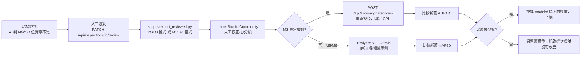

# 技術決策與理由（Phase 0–15）

> 原本位於 `CLAUDE.md`，Phase 16 起搬到此處，內容保留（僅將定位用語改為正式產品用語）。

## 技術決策與理由（Phase 1）

- **後端：FastAPI + Uvicorn**，Python 3.11（`uv venv --python 3.11`，系統原生只有 3.9/3.10/3.13/3.14，改用 uv 裝 3.11）。
- **LLM 抽象層**（[backend/core/llm.py](backend/core/llm.py)）：`LLM_ENGINE=ollama`（預設）或 `gemini`（備援），模組只呼叫 `generate_json(prompt, image)`，不需要知道底層引擎。
  - Ollama 預設模型 `qwen3.5:9b`（6.6GB、Apache-2.0，2026-09 查證版本，多模態）。`qwen3-vl:8b` 為備選。`qwen3.6`／`qwen3.8` 最小為 27B，16GB Mac 跑不動，不採用。
  - `ollama.Client.chat(..., format="json", think=False)` 強制輸出 JSON，關閉思考模式減少延遲；找不到模型或連不上 Ollama 時回傳清楚的錯誤訊息（提示 `ollama pull` 或 `ollama serve`）。
  - JSON 解析失敗會回傳 502 錯誤，不會硬塞假資料掩蓋問題。
- **共用回應格式**（[backend/core/schemas.py](backend/core/schemas.py)）：`{module, verdict, items, annotated_image, engine, elapsed_ms, inspection_id}`，所有模組一致，方便之後 ERP 串接。
- **檢驗紀錄**（[backend/core/inspection_log.py](backend/core/inspection_log.py)）：SQLite（`data/inspections.db`，不進版控），每次辨識寫一筆，`GET /api/inspections?module=&verdict=&date_from=&date_to=` 查詢，`/api/inspections/export.csv` 匯出（含 BOM，Excel 開啟中文不亂碼）。Phase 9 起新增追溯欄位、原圖/標註圖存檔（`data/images/`）、人工複判、看板統計，見下方「技術決策與理由（Phase 9）」。
- **目錄結構**：`backend/core/`（共用工具）、`backend/modules/<模組>/{router.py,service.py}`（每個模組獨立）、`tests/`（pytest，測試圖由 `tests/samples/make_samples.py` 程式生成，不依賴外部授權圖片，不進版控）。
- **M9 開放式辨識**：原「街景辨識」改為現場照片辨識，prompt 改成機台/工具/零件/標示/安全觀察情境，新增「可見文字」「安全觀察」欄位。
- **M4 製造文件結構化**：Phase 1 沿用 Tesseract 兩段式 + 端到端兩種模式（欄位命名改成工單/出貨單/檢驗報告情境），改走 LLM 抽象層。Phase 4 會換成 RapidOCR + Pydantic schema（理由見下方套件決策）。
- **套件版本鎖定不用 PaddleOCR**：用 `uv pip compile` 實測，Python 3.11 環境下 `paddlex` 要求 `numpy<2.4`，會把 `paddleocr` 拖回 2.10.0 舊版且 macOS 只有 CPU 版；改用 RapidOCR（同樣是 PP-OCR 模型的 ONNX 版，Apache-2.0，相依乾淨）。
- **測試策略**：單元測試（`pytest`，預設執行）用假的 `core.llm.generate_json` / `modules.safety.service._detect_persons` 隔離 LLM 與 YOLO，只驗證 API 契約、SQLite 寫入、錯誤處理、業務邏輯（GS1 解析、效期判斷、多邊形入侵判斷）；`-m live` 標記的測試會真的呼叫本機 Ollama／YOLO，驗證真實延遲與準確度，預設不跑。

## 技術決策與理由（Phase 2）

- **M1 追溯碼（`backend/modules/codes/`）**：`zxing-cpp` 解碼，GS1 條碼的 `barcode.text` 預設就是 `(AI)值(AI)值...` 的人類可讀格式（`TextMode.HRI`），不需要自己處理 FNC1 分隔符號；(17) 效期用 GS1 規則（YY 00-50→20xx、51-99→19xx，DD=00 代表當月最後一天）換算，已過期 NG、30 天內到期標「即將到期」（不算 NG）。
- **M2 計數（`backend/modules/measure/`）**：一開始用「distance transform 整塊閾值」分割相黏零件失敗（兩顆相黏的圓被當成一顆，面積是單顆的 2 倍），改用「距離變換的局部極大值當種子點」才能正確分離——原因是整塊閾值下，兩顆圓重疊處的距離值仍高於閾值，前景還是連通的；局部極大值抓的是各自的中心峰值，不受這個影響。
- **M2 量測**：ArUco 標記四角做 homography 透視校正，把整張圖攤平成固定 px/mm 的正視圖再量測。實測系統性誤差約 0.3-0.6mm（50mm 零件上約 1%），來源是 ArUco 邊界像素化與二值化邊緣效應；預設公差從原規劃的 0.5mm 調整為 1.0mm 較務實。
- **M5 危險區域入侵（`backend/modules/safety/`）**：YOLO 選用 `yolo11n.pt`（成熟穩定、COCO person 類別）而非同批發布的 `yolo26n.pt`（2026-09 才發布的最新架構，尚無足夠驗證案例）；人員判定用「邊界框底邊中點（腳底參考點）」是否落在使用者畫的多邊形內（`cv2.pointPolygonTest`），而非用整個框判斷，理由是危險區域通常畫在地面，用腳底位置比整個人形框更符合實際「站在哪裡」的語意。Phase 2 只做單張圖片，短影片逐幀抽樣留到 Phase 5 跟 PPE 一起做。
- **live 測試用真實照片**：M5 的自動偵測準確度用合成圖驗證不出意義（YOLO 認的是真人特徵），改抓 Wikimedia Commons 的 CC BY 2.0 授權工廠照片（`tests/live_samples/`，不進版控，來源見 `docs/licenses.md`），95.1% 信心度正確偵測到人。

## 技術決策與理由（Phase 3）

- **M3 異常檢測（`backend/modules/anomaly/`）**：Anomalib PatchCore，非監督式——只用良品照片擬合一個特徵記憶庫（memory bank），不需要 NG 樣本，這正對應工廠現場「良品多、NG 樣本稀少」的真實情境。骨幹網路用預設的 `wide_resnet50_2`（ImageNet 預訓練，Apache-2.0，只做前向推論抽特徵，不重新訓練）。
- **PatchCore 固定用 CPU，不用 MPS**：實測 MPS 反而比 CPU 慢很多，原因是 coreset 貪婪演算法逐元素呼叫 `.item()` 觸發 GPU 同步（見已知限制、Phase 3 測試紀錄的除錯過程）。這跟 Phase 0 原本規劃的「MPS 優先，不支援才退回 CPU」不同——MPS 是支援的，只是這個特定演算法在 MPS 上特別慢，所以固定用 CPU。
- **訓練與推論分離**：`scripts/train_anomaly.py` 離線擬合＋用 `anomalib.deploy.ExportType.TORCH` 匯出成 `TorchInferencer` 可直接載入的 `.pt`（包好 pre-processor 與門檻值），服務層（`backend/modules/anomaly/service.py`）只做推論、不依賴完整的 Lightning 訓練環境概念，載入後常駐記憶體、依 category 分開快取。
- **熱力圖標註**：`anomaly_map` 正規化到 0-1 後用 `cv2.COLORMAP_JET` 上色疊在原圖上（紅＝異常機率高），跟其他模組共用的 `annotated_image` 欄位格式一致。
- **信任本機權重**：anomalib 的 `TorchInferencer` 預設拒絕 unpickle 權重檔（防惡意程式碼），只在載入自己訓練產生的權重時設定 `TRUST_REMOTE_CODE=1`，並在程式碼註解寫清楚為什麼這樣做是安全的（不是無條件關掉資安檢查）。

## 技術決策與理由（Phase 4）

- **M4 換成 RapidOCR（`backend/core/ocr.py`）**：取代 Phase 1-3 暫時沿用的 Tesseract。實測工單號 `WO-2026-0915`，Tesseract 會誤讀成 `WO-2026-0215`（數字 9→2），RapidOCR 讀得完全正確——這不是理論上的優勢，是同一張測試圖跑出來的真實差異。Tesseract 保留成 `mode=tesseract` 比較選項（`backend/core/tesseract_ocr.py`），不是直接砍掉。
- **表格結構辨識（`RapidTable`）**：出貨單的品項表格用 `rapid-table`（`slanet-plus.onnx`）解析成 HTML 表格，當作額外上下文餵給 LLM，幫助多列品項的解析更準；表格辨識失敗時退回純文字，不讓整個請求掛掉。`rapid-layout` 裝了但這個 Phase 沒用到（目前三種文件都是單一區塊版面，不需要版面分析；留給之後 M7 銘牌/複雜版面用）。
- **嚴格 schema（`backend/schemas/documents.py`）**：工單／出貨單／進料檢驗報告三種文件定義 Pydantic model，LLM 回傳的 JSON 一律過 `model_validate()`；驗證失敗回傳 `_驗證錯誤`（逐欄位列出問題），不會用預設值把錯誤蓋過去。報價單／名片／其他文件類型沿用原本的自由格式（不硬套 schema，因為欄位天生因文件而異）。
- **數字來源核對（防止 LLM 捏造數字）**：所有數字欄位都用 `{值, 原文片段}` 的格式，LLM 除了給數字還要附上「這是從原文哪裡抄的」；service 層（`_annotate_source_verification`）拿這段原文片段去對 OCR 真實文字做子字串比對，比對得到標「OK」，比對不到標「可疑：原文中找不到這段文字，數字可能是 LLM 捏造的」——這個檢查完全不靠 LLM 自己說了算。端到端模式沒有獨立 OCR 文字可以核對，誠實標記「無法驗證」，不假裝驗證過。
- **文件類型判斷分兩段 LLM 呼叫**：先分類（`文件類型`），再依分類結果決定要不要套嚴格 schema、要用哪個 schema 專用 prompt。兩段式比一段式多一次 LLM 呼叫的延遲，換來的是每種文件類型可以給非常明確的目標 JSON 結構範例，而不是要 LLM 自己猜欄位名稱。

## 技術決策與理由（Phase 5）

- **M6 PCB 瑕疵偵測（`backend/modules/defect/`）**：監督式 YOLO11n，跟 M3（PatchCore，非監督）刻意互補——M3 不需要 NG 樣本但只能說「哪裡異常」，M6 需要標註過的 NG 樣本（DeepPCB）但能講出「是哪一種瑕疵」（斷路/短路/缺口/毛刺/多餘銅箔/針孔）。
- **DeepPCB 官方沒有切分清單，自己切**：官方 README 只說「1000 張當訓練集，其餘當測試集」，沒附清單。`scripts/prepare_deeppcb.py` 用固定亂數種子（42）切 1000/250/250，可重現，並在程式註解與文件裡誠實寫「不是官方切分」。
- **MPS 訓練 YOLO 沒有 M3 PatchCore 那個坑**：M3 的 coreset 演算法在 MPS 上因逐元素 `.item()` 同步而極慢；YOLO 的訓練是標準卷積+反向傳播，MPS 支援良好，實測 M1 Pro 上 1 epoch（1000 張、batch16）約 47 秒，PCB 模型 41 epoch（early stop）只花 32 分鐘。這跟 M3 的結論不衝突——「MPS 對某些特定演算法很慢」不等於「MPS 對深度學習訓練普遍很慢」。
- **ultralytics 的 `project` 路徑陷阱（真的踩到，見下方測試紀錄）**：`project='models/defect'` 這種相對路徑會被 ultralytics 全域設定的 `runs_dir` 加上前綴，實際存到 `runs/detect/models/defect/...`，不是我以為的 `models/defect/...`。PPE 訓練改用絕對路徑 `project='/Users/.../models/ppe'` 避開這個陷阱。
- **M5 PPE 只有兩類（helmet/head）**：Hard Hat Workers 資料集本身沒有反光背心類別，這是 Phase 0 就查證過的資料集限制，不是這個 Phase 漏做；沿用資料集自帶的 Train/Test 切分（不像 DeepPCB 要自己切）。

## 技術決策與理由（Phase 6）

- **先測 OCR 再決定要不要自己做（照規劃的順序）**：七段顯示器實測 RapidOCR 完全偵測不到文字（`text detection result is empty`），Tesseract 把數字亂猜成中文字（`世紀二`）。兩個都不能用，才照規劃改用 OpenCV 逐段判讀（`backend/core/seven_segment.py`），不是預設就寫死走 OpenCV。
- **七段判讀不用膨脹黏合**：一開始用膨脹（dilate）讓斷開的線段黏成一個連通元件，結果反而把小數點跟隔壁數字黏在一起、也把緊致邊界框撐大到取樣點對不準線段位置。改成不做任何形態學處理，直接對原始二值圖做連通元件分析——只要線段有在轉角共用像素（正常畫法本來就是），一個數字自然就是一個連通元件，小數點因為高度矮很多會自然分開成獨立元件，不需要膨脹。
- **數字「1」要特判**：「1」只有右側兩條線段，緊致邊界框寬度遠小於其他數字，若照 7 個比例取樣點去取樣，取樣窗口會意外全部落在同一條線上而誤判成「8」。用「寬度明顯小於其他數字寬度中位數」直接特判成 1，不跑一般的七段比對。
- **指針錶角度慣例選 atan2(dy,dx)**：0 度＝3 點鐘方向，順時針遞增（因為圖片座標 y 軸向下，這剛好是最自然、不用額外轉換正負號的方向）。圓心找不到時要求使用者手動輸入正規化座標，不硬猜。
- **指針角度換算成讀值抓到一個真實 bug（不是預想到才防的）**：指針剛好落在 `min_angle` 邊界附近（134.7° vs min_angle=135°，只差 0.3° 的量測雜訊），原本的邏輯把「角度略小於 min_angle」一律當成「指針繞了一整圈從另一端過來」，讀值從該接近 0 跳成 100。改成同時算「角度」跟「角度+360」兩種解讀，取夾範圍前比例離 [0,1] 較近的那個，邊界雜訊就不會被誤判成整整繞一圈。這個 bug 是實際測試邊界情況才發現的，寫了對應的 `test_gauge_boundary_noise_does_not_wrap_to_opposite_end` 測試釘住，不會再退化。
- **銘牌沿用 M4 的單段 LLM 呼叫模式**（不是兩段式）：因為銘牌不需要先判斷文件類型，直接一次 OCR 文字→固定 schema（`backend/schemas/nameplate.py`）結構化，比 M4 簡單。

## 技術決策與理由（Phase 7）

- **M8-1 包裝檢核重用 M1 的條碼解析**：`backend/modules/codes/service.py` 的 `describe_barcode()`（原本是模組內部函式 `_describe_barcode`，這次改成公開函式給 M8 匯入重用，不重寫一份重複邏輯）解出 GS1 條碼的批號/效期，再用 RapidOCR+LLM 讀印刷文字上的批號/效期，兩邊比對。這正是 GMP 追溯的真實情境：條碼跟印刷文字對不上，代表包裝可能印錯或貼錯條碼，比單獨檢查條碼或單獨檢查印刷文字更能抓到真實瑕疵。
- **比對邏輯明確區分「不一致」跟「沒辦法比對」**：兩邊有一邊沒讀到資料時回傳 `None`（沒辦法比對），不會被當成「不一致」硬判 NG——OCR 讀不到印刷文字很常見（印刷模糊、被遮擋），不該因為讀不到就誤報瑕疵。
- **M8-2 選 PneumoniaMNIST 而非其他 MedMNIST 子集**：規劃就指定用這個資料集，CC BY 4.0（DermaMNIST 是 CC BY-NC 4.0，不能用）；28x28 灰階、二元分類，CPU 15 epoch 只要 19.4 秒，適合當「教學展示」而不是要花很久訓練的正式模型。
- **開發中抓到訓練集類別不平衡的真實 bug**：PneumoniaMNIST 官方訓練集是 normal 1214 張、pneumonia 3494 張（約 1:2.9），第一版沒處理不平衡，訓練出來的模型對 normal 的召回率只有 55.6%（234 張正常樣本裡 104 張被誤判成肺炎）——這是拿真實照片測試才發現的，不是憑空猜的。加上 `pos_weight`（`BCEWithLogitsLoss` 內建的類別權重參數）調降多數類別（pneumonia）的損失權重後，normal 召回率提升到 74.8%，整體測試集 ACC 從 0.8285 提升到 0.8862、AUC 從 0.9284 提升到 0.9346。`scripts/train_medmnist.py` 現在會把 normal/pneumonia 各自的召回率都寫進 `metrics.json`，不是只看整體 ACC 掩蓋類別偏差。
- **警語要在三個地方都出現**：API 回應的 `item["警語"]`、前端分頁的紅色粗體警語文字、`docs/licenses.md` 的資料集用途說明，三處都寫「僅供技術展示，非醫療診斷用途」，不是只在某一處交代就算了。
- **這個模組的 `verdict` 一律回傳 INFO**：不是 OK/NG，因為這不是品檢判斷，用 OK/NG 容易被誤讀成「AI 判定這個人健康/生病」的結論性語氣。

## 技術決策與理由（Phase 8）

- **截圖產生工具選 Playwright，不是既有的瀏覽器自動化工具**：試過三種方案都不行——`mcp__claude-in-chrome__computer` 的 `save_to_disk` 參數其實不存在（呼叫會被靜默忽略，截圖存不到任何找得到的地方，查了實際 fetch 到的 tool schema 才確認）；內建瀏覽器（`mcp__Claude_Browser__*`）整組工具沒有檔案上傳功能，跟專案 CLAUDE.md 原本記載的限制一致；`mcp__computer-use__*` 全螢幕操作對瀏覽器只給「read」權限（不能點擊），且 `app_list_windows` 抓到的是使用者自己在瀏覽的無關視窗，抓不到自動化分頁。改裝 Playwright（純 Python，另開一個獨立 headless Chromium）後可以直接 `page.set_input_files()` 上傳、`page.screenshot(path=...)` 存檔，完全不受任何 GUI 自動化工具的權限分級限制。只在 venv 額外裝，不進 `requirements.txt`（一次性文件用工具，不是 app 執行期相依）。
- **M5 危險區域截圖踩到 canvas 座標的真實 bug**：第一次產生的 `06_safety.png` 危險區域判定是 `false`（沒有示範到更有意義的 NG 案例），畫出來的多邊形視覺上只有一條線、不是封閉四邊形。用 `page.mouse.click(絕對頁面座標)` 點擊 canvas 下半部的兩個點時，那兩個點的 y 座標已經超出瀏覽器 viewport 高度（900px）——canvas 圖片高度撐開了整個頁面，下半部的點落在「需要捲動才看得到」的範圍，但 `page.mouse.click` 是對 viewport 座標直接派發滑鼠事件，不會像真人滑鼠一樣先捲動視窗，所以那兩次點擊完全沒有命中 canvas，只有前兩個點成功記錄，畫出的只是一條線而非四邊形。改用 `locator.click(position=...)`（相對 canvas 左上角的座標，Playwright 會自動先把該元素捲進可視範圍再點擊）後，4 個頂點都正確記錄，重新產生的截圖正確顯示「危險區域: true」與半透明紅色覆蓋區。這是先看到截圖內容不合預期（`危險區域: false` 是意外結果，不是預期中的示範案例），照著「Surprise is signal」去查才抓到的，不是預先猜到才防的。
- **README「未納入功能」直接引用規劃文件原文**：`docs/dev/plans/manufacturing-ai-plan-prompt.md` 已經寫好每一項未納入功能的具體原因（付費軟體、需要硬體、資料集授權不明、非影像辨識範疇等），沒有重新編造理由，同時補上一項規劃文件裡沒單獨列出但實際發生過的案例：M6 原規劃第一選項 NEU-DET 資料集在 Phase 0 查證時就發現官方頁面沒有授權條款，因此改用 DeepPCB（MIT），這個決策原因值得跟其他「未納入」項目放在一起說明。

## 技術決策與理由（Phase 9）

第二輪規劃（`docs/dev/plans/next-phase-gap-plan-prompt.md`）第一個 Phase：從「13 個辨識分頁的系統」補到「可以上產線、可以接 ERP 的品檢系統」，這個 Phase 補檢驗紀錄的追溯欄位、原圖/標註圖存檔、人工複判、品檢看板。

- **追溯資訊傳遞選方案 A（HTTP header + contextvar），不改 13 個 service.py 的函式簽名**：使用者在開工前回報階段明確選定。新增 `backend/core/context.py` 存兩個 `ContextVar`：`TRACE_CTX`（工單/料號/批號/站別/操作員，由 `main.py` 的 `@app.middleware("http")` 從 header 讀進去）與 `RAW_IMAGE_CTX`（原始圖片 bytes，由 `core/image_io.load_image()` 讀圖成功後塞進去）。`inspection_log.record_result()` 內部讀這兩個 contextvar，13 個模組的呼叫方式完全不用改。前端 header 值一律用 `encodeURIComponent` 編碼、後端用 `urllib.parse.unquote` 解回來，避免中文站別/操作員名稱塞進 HTTP header 出錯（HTTP header 理論上只保證 latin-1）。
- **contextvar 跨 threadpool 傳遞是要驗證的假設，不是可以憑經驗直接相信的事**：13 個模組的路由都是 `def`（非 `async def`），FastAPI/Starlette 會用 `anyio.to_thread.run_sync` 丟進 threadpool 執行；middleware 是 `async def`，在 event loop 執行。這代表 `TRACE_CTX.set()` 發生在 event loop 的 context，`record_result()` 讀值發生在 threadpool 的 context，兩者要靠 `contextvars.copy_context()` 正確傳遞才會拿到同一份值。這點沒有假設它「應該會動」，而是寫了 `tests/test_inspections.py::test_trace_headers_recorded_and_optional` 實際發真實 HTTP 請求（含中文操作員姓名）驗證，確認 header → middleware → threadpool 裡的 service → `record_result()` 全程資料一致。
- **原圖/標註圖存檔路徑先寫入再回填**：`record_result()` 流程是「先 INSERT 一筆拿到 `inspection_id`」→「用這個 id 當檔名 `data/images/YYYY-MM-DD/<id>_raw.<ext>`／`<id>_annotated.png` 存檔」→「再 UPDATE `image_path`/`annotated_path` 回這筆紀錄」，不是反過來用檔名反推 id。理由：檔名需要先有 id 才能唯一，而 SQLite `AUTOINCREMENT` 的 id 只有 INSERT 後才知道，沒有辦法在同一個 INSERT 語句裡同時算出檔名再塞進同一個欄位。
- **migration 用 `PRAGMA table_info` 檢查而非版本號欄位**：`_migrate()` 每次連線都跑 `PRAGMA table_info(inspections)` 拿現有欄位集合，缺哪個 Phase 9 新欄位就補哪個，不用維護一個獨立的 schema version 表。這對這個專案規模（單一 SQLite 檔、欄位只會越加越多不會改型別）夠用；換來的好處是舊 db（哪怕是 Phase 1 剛建的最原始 6 欄位 schema）直接跑起來就自動補齊，寫了 `test_legacy_db_auto_migrates_and_old_data_still_queryable` 用手動建的舊 schema db 驗證這件事，不是只看程式碼邏輯就相信會動。
- **良率計算排除 INFO**：`verdict=INFO` 的模組（M9 開放式辨識、M8-2 醫學影像分類展示、沒畫危險區域的 M5、找不到七段/指針錶結構的 M7 等）本來就不是「良品或不良品」的品檢判斷，`_yield_rate()` 只拿 OK/NG 當分母，INFO 完全不列入良率計算，避免看板出現「良率 85%」但其實有一半資料根本不是品檢判定的誤導數字。
- **NG 原因柏拉圖的缺陷類別抽取是白名單制，不是動態掃 summary_json**：`inspection_log.py` 用 `@_extractor(module)` 裝飾器明確為 `defect`／`ppe`／`anomaly`／`safety`／`medical_packaging` 五個模組各自寫一個「怎麼從 items 抽出缺陷標籤」的函式（例如 defect 抓 `明細[].瑕疵類型`、ppe 只算「未戴安全帽」不算「已戴安全帽」、anomaly 抓 `判定=="異常"` 時的 `類別`）。沒有規則的模組（M9/M1/M4/M7/M8-2）`extract_defect_labels()` 直接回傳 `[]`，不會用「猜欄位名稱」的方式硬湊出不存在的缺陷分類，這也是為什麼這個函式不是用一個通用的「掃 summary 裡所有字串值」邏輯，那樣會把「主要物件」「可見文字」這種非缺陷欄位也混進柏拉圖。
- **`AI 判定 vs 最終判定 vs 一致率」用真實資料交叉驗證出來，不是只看程式碼推導**：用瀏覽器把一筆 PCB 瑕疵（AI 判 NG）複判成 OK 後，看板即時反映：該模組「最終良率」從 0% 變成 12.5%（8 筆裡有 1 筆最終判 OK）、「AI／人工一致率」從 100%（改判前只有 1 筆複判且與 AI 一致）掉到 0%（這筆複判結果跟 AI 判定不一致）。這證明 `_final_verdict()`（`review_verdict` 有值就蓋過 `verdict`）與一致率公式（`review_verdict == verdict` 才算一致）確實照設計運作，不是憑程式碼讀起來合理就假設會動。
- **Chart.js 存本機 `frontend/vendor/`，不用 CDN**：查證 GitHub `master` 分支 `package.json` 版本 4.5.1、MIT 授權，下載 `chart.umd.min.js`（208KB）進版控。理由同硬性規則第 2 條「核心完全離線執行」——看板是品檢日常會用的功能，不應該因為離線環境或 CDN 掛掉就失效。

## 技術決策與理由（Phase 10）

ERP 串接介面 + 基本資安。使用者在開工前回報階段確認兩個關鍵取捨：**API Key 只保護 `/api/inspections*`**（13 個辨識端點不用 key）、**webhook 用 daemon thread 立即送、失敗才進佇列**（不是全部先進佇列靠背景執行緒統一送）。

- **只保護 `/api/inspections*`，13 個辨識端點刻意不用 key**：辨識端點只有前端同源呼叫，CORS 白名單已經擋掉外部網域；真正的敏感面是 `/api/inspections*`——ERP 會定期輪詢、含原圖/標註圖、含所有追溯資訊。新增 `backend/core/api_auth.py` 集中管理，`main.py` 加一個 middleware 只在 path 以 `/api/inspections` 開頭時檢查，不用逐一在 13+5 個 router 上加 `Depends`。
- **key 支援 header 與 query 參數兩種帶法**：`X-API-Key` header 是主要方式（ERP 輪詢走這個）；`?api_key=` query 參數是給 `` 與純連結下載（CSV 匯出）用——瀏覽器原生機制沒辦法在這兩種情境帶自訂 header。這代表 key 可能出現在瀏覽器歷史紀錄或伺服器 access log，在單機、沒有對外網路曝露的單機部署情境下是可接受的取捨；`core/api_auth.py` 的 docstring 跟 `docs/erp-integration.md` 都寫清楚這個限制，不是沒想到就漏掉。
- **前端 key 是寫死在 `frontend/index.html` 的常數 `FRONTEND_API_KEY`，要跟 `.env` 的 `API_KEYS` 手動保持一致**：這是單機部署的簡化（沒有做「後端把 key 動態注入前端」的機制，例如模板渲染或一個 `/api/config` 端點），換 key 需要兩邊一起改。正式多人使用的系統不會這樣做，但這個 Phase 的範圍就是「單機部署接單一 ERP」，做一個設定同步機制超出這個 Phase 的必要性。
- **webhook 送出機制：`record_result()` 判 NG 時開一個 daemon thread 立即用 `httpx.post()` 送出，主執行緒完全不等待**，送出失敗（例外或非 2xx）才寫進新的 `webhook_queue` 表，由 `main.py` 的 `lifespan` 啟動的背景執行緒每 30 秒掃一次重試，超過 5 次放棄但保留紀錄（不刪除，方便事後排查）。這個設計的核心約束是「NG 事件不能因為 ERP 那端掛掉而拖慢辨識 API」，寫了 `test_ng_webhook_receiver_down_response_still_ok_and_queued` 用一個保證連不上的 port 驗證：辨識 API 仍在 2 秒內回應（實際遠低於 `httpx` 5 秒的 timeout，因為主執行緒根本不等 thread 完成），且失敗後確實進了佇列。
- **`webhook_queue` 表跟 `inspections` 表共用同一個 SQLite 連線邏輯（`inspection_log._connect()`）**：Phase 10 沒有另開一個資料庫檔案，`webhook_queue` 的 `CREATE TABLE IF NOT EXISTS` 跟著 `inspections` 的 base schema 一起在 `_migrate()` 執行，這代表舊 db（甚至 Phase 1 的最原始 schema）一樣會自動補上這張表，不需要額外的 migration 邏輯。
- **`CORS_ORIGINS` 是「啟動時讀一次」，不是「每個請求都重讀」**：`main.py` 的 `_cors_origins = os.environ.get(...)` 跟 `app.add_middleware(CORSMiddleware, allow_origins=[...])` 都在模組載入時執行一次，Starlette 的 `CORSMiddleware` 本身設計就是把白名單「烤進」中介層物件，不支援動態改。這是寫測試時真的踩到的坑：一開始想用 `monkeypatch.setenv("CORS_ORIGINS", ...)` 改了再發請求驗證，結果因為 `main` 模組在更早的測試就已經 import 過、`app` 是全 session 共用的單例，monkeypatch 完全不影響已經建好的 middleware，測試看起來會過但驗證的其實是「假象」（改了 env 但中介層還是舊設定）。改成直接測預設白名單（`127.0.0.1:8000` 允許、`evil.example.com` 不允許）才是測到真正在跑的行為；`docs/erp-integration.md` 跟已知限制都寫清楚「改 `CORS_ORIGINS` 要重啟服務才生效」。
- **`since_id` 升冪 vs 預設降冪，刻意用同一個端點的不同參數區分，不是開兩個端點**：`GET /api/inspections`（品檢看板用）預設 `ORDER BY id DESC`（最新在最上面比較符合人看的直覺）；`GET /api/inspections?since_id=<n>`（ERP 輪詢用）強制 `ORDER BY id ASC`（游標往前推進才合理）。兩者共用 `query_inspections()`，用「有沒有傳 `since_id`」這個參數本身決定排序方向，而不是另外開一個 `?order=asc` 參數，因為這兩種用途在實務上就是綁定的——沒有人會想要「用 `since_id` 篩但降冪排序」這種組合。
- **C# 範例真的建了一個最小 console 專案跑 `dotnet build` 驗證**（`docs/erp-integration-sample/`，含 `Microsoft.Data.SqlClient` NuGet 套件），不是照抄語法看起來對就假設能編譯；0 警告 0 錯誤編譯成功，SQL Server 連線本身沒有真的跑（需要真實 SQL Server 執行個體），這點在文件裡誠實註明。建置產物（`bin/`、`obj/`）加進 `.gitignore`，只留原始碼。

## 技術決策與理由（Phase 11）

產線化輸入：資料夾監控、批次 API、M5 短影片抽幀、瀏覽器拍照。使用者確認跳過 RTSP 定時抓圖（選做項目，沒有實體 IP Cam）。

- **批次 API 用「動作」不用「module」當 key**：計畫文件寫 `POST /api/batch/{module}`，但 `measure`（count／measure 兩個獨立端點）、`nameplate`（read／seven-segment／gauge 三個獨立端點）用 module 名稱當 key 會有歧義（`measure` 批次該對應哪一個？）。改用 13 個分頁實際呼叫的 14 個「動作」代號（`backend/core/batch_dispatch.py` 的 `ACTIONS` dict），`scripts/watch_folder.py` 的 `ACTION_URLS` 用同一組代號，兩份對照表註明「要保持一致」而不是共用同一份程式碼——因為 watch_folder.py 是獨立跑的腳本，不依賴 backend 套件內部結構，換取的是腳本可以獨立執行不用管 backend 的 import path。
- **批次上傳單張失敗不中斷整批**：`run_batch()` 逐檔 try/except（`ModuleError` 與其他未預期例外都接住），失敗的檔案記在 `results` 裡標 `status: "error"`，其餘檔案繼續處理。寫了 `test_batch_one_bad_file_does_not_abort_the_rest` 驗證中間一張壞檔不影響前後兩張好檔都成功。
- **批次整批共用同一組額外參數（category/zone/mode 等），不是每張各自設定**：符合實務情境——同一批要送去 M3 異常檢測的照片通常是同一個料號（同一個 `category`），同一批危險區域入侵照片通常來自同一台固定攝影機（同一個 `zone`）。這是刻意的範圍限制，不是遺漏；已知限制有寫清楚。
- **M5 影片端點重構出「純偵測（吃 BGR ndarray）」共用邏輯**：`_detect_intrusion_on_bgr()`／`_detect_ppe_on_bgr()` 抽出來給單張圖片與影片逐幀共用，影片端點不是複製一份偵測邏輯——這是計畫文件要求的「小幅重構」，改動範圍刻意限縮在這兩個函式的拆分，沒有動到其他無關的程式碼。
- **影片逐幀處理用 `cap.set(CAP_PROP_POS_MSEC, t*1000)` 直接跳到時間點，不是逐幀 decode 全部畫面再篩選**：60 秒影片、1 秒取樣間隔只需要解碼 60 幀左右，不用管影片實際幀率多高，避免真實影片（例如 30fps 的 60 秒影片有 1800 幀）逐幀解碼造成不必要的效能浪費。
- **影片存到暫存檔才能用 `cv2.VideoCapture` 讀**：OpenCV 的 `VideoCapture` 不支援直接吃記憶體 bytes（不像 Pillow 的 `Image.open(BytesIO(...))`），`_sample_video_frames()` 用 `tempfile.NamedTemporaryFile` 寫暫存檔案，`with` 區塊結束自動清掉，不會在 `data/` 或專案目錄留下暫存影片檔案。
- **影片彙總紀錄的 `annotated_image` 選「第一個違規幀」，沒違規時退回「最後取樣幀」**：讓看板/複判介面點開一筆影片辨識紀錄時，看到的是最有代表性的畫面（有違規優先秀違規畫面），而不是隨便一幀空景。違規清單裡每個時間點另外存一張縮圖（`VIDEO_THUMBNAIL_MAX_SIDE=320`，比原尺寸小很多），避免長影片有很多違規時單筆 JSON 過度肥大。
- **拍照用共用 modal + `DataTransfer` 塞回既有 `<input type=file>`，不是另開一套上傳邏輯**：`openCamera()`/`camera-capture-btn` 拍完後把 Blob 包成 `File` 塞進目標分頁的檔案輸入框並手動 dispatch `change` 事件，這樣下游的 `setupPreview()`／批次判斷／送出邏輯完全不用為了「拍照來源 vs 檔案選擇來源」寫兩套分支。13 個分頁（含 safety）都加了拍照按鈕；只有 safety 分頁的 `<input>` 刻意沒加 `multiple`，因為那個分頁的畫危險區域多邊形是針對單一張圖片的互動，批次多選跟這個 UI 模式衝突（拍照仍然可用，只是拍出來是單張）。
- **開發中真的用 Playwright 搭配假相機裝置（`--use-fake-device-for-media-stream`）驗證拍照流程，不是只看程式碼邏輯合理就假設會動**：`getUserMedia` 這種瀏覽器原生 API 沒辦法用單元測試涵蓋，寫了一次性 Playwright 腳本（不是常駐測試，跟 `scripts/capture_screenshots.py` 的角色類似）：開相機→等 video 元素可見→點擊拍照→確認 modal 關閉、預覽圖出現、`<input>` 的 `files` 真的多了一個 `File` 物件→送出後真的打 Ollama 拿到辨識結果。這證明了整條「假相機→Blob→File→DataTransfer→現有上傳流程→真實 API 呼叫」鏈路是通的，不是只驗證了某一段。
- **開發中意外抓到一個跟 Phase 11 無直接關係、但透過即時驗證發現的真實 bug（`core/image_io.py`）**：用真實伺服器測 `watch_folder.py` 丟壞檔進 error 資料夾時，API 回傳的是 500 而不是預期的 400。追下去發現：`ultralytics` 匯入時會 monkeypatch `PIL.Image.open`（加 HEIF 支援），當 Pillow 對一段不是圖片的 bytes 做格式辨識失敗時，被 patch 過的 `Image.open` 會嘗試 lazy import `pi_heif`；這個套件沒裝（也不在 `requirements.txt`），丟出的是 `ModuleNotFoundError`，不是 `load_image()` 原本攔截的 `UnidentifiedImageError`/`OSError`，所以直接變成未攔截的 500。只有在某個請求已經觸發過 `import ultralytics`（例如呼叫過 M5/M6 任何一個端點）之後，這個 monkeypatch 才會生效，這也是為什麼 Phase 1-10 的單元測試從來沒踩到——測試執行順序或假 fixture 沒有觸發真的 `import ultralytics`。修法是把 `load_image()` 讀圖那段的 `except` 從 `(UnidentifiedImageError, OSError)` 放寬成 `Exception`，因為這個函式的語意合約本來就是「bytes 讀不出圖片就回 400」，不該因為底層第三方套件的例外型別而洩漏成 500。這個 bug 完全是靠「拿真實伺服器測真實情境」才抓到的，單元測試（`TestClient`，沒有先觸發 ultralytics import）測不出來。

## 技術決策與理由（Phase 12）

自有資料導入流程：M3 自訂類別（zip 上傳 + 背景排隊擬合 + 門檻調校）、複判資料回流匯出。使用者確認標註校正工具選 **Label Studio Community**（Apache-2.0）。

- **自訂類別擬合用 `anomalib.data.Folder`，不是硬套 `MVTecAD` datamodule**：`MVTecAD` 綁死官方目錄結構（含像素級 `ground_truth/` 遮罩），使用者上傳的 zip 不會有這種遮罩。`scripts/train_anomaly.py` 新增 `train_custom()`，用 `Folder(normal_dir=..., root=...)`；`train_one()`（既有三個示範類別）完全沒動，兩者是平行的兩條路徑，不是重構共用。
- **良品照片自己先切一部分（20%）留著評分用，不是讓 anomalib 的 Folder 自動切測試集**：`train_custom()` 用固定種子（42）洗牌後把良品切成「擬合用（80%）」跟「held-out 評分用（20%）」，擬合只餵 80% 給 `Folder(normal_dir=...)`（不提供 `abnormal_dir`/`normal_test_dir`），擬合完用**匯出後的 `TorchInferencer`**（跟正式推論路徑完全一樣的程式碼）對 held-out 良品 + 全部 NG 照片逐張評分，寫成 `scores.json`。這個設計換來的是評分邏輯完全掌握在自己手上、跟正式推論路徑一致，不用去猜 anomalib 內部 `Folder`／`test_split_mode` 對「沒有 mask」情境的語意。
- **真實踩到的 bug：anomalib 內建的 min-max 分數正規化會把良品跟 NG 的分數大量裁到剛好卡在 0 或 1，讓門檻建議完全失真**：第一次用 MVTec `bottle`（Phase 12 驗收指定的類別，模擬「自家零件」）跑完整流程，AUROC=0.9762 看起來正常，但 ROC/Youden's J 選出來的門檻剛好是 `1.0`——一個明顯退化的數字。查了 `scores.json` 才發現：42 張 held-out 良品裡有好幾張分數精確等於 `1.0`，63 張 NG 照片**全部**都是 `1.0`。追進 `anomalib.post_processing.PostProcessor` 原始碼，確認 `image_min`/`image_max` 這兩個正規化統計值只在 Lightning 的 validation 階段用 `MinMax` metric 累積——而 `Folder` datamodule 在我只給 `normal_dir`（80% 良品）的情況下，會自己內部再切一小塊「良品」當驗證集，這塊驗證集分數範圍天生就很窄（畢竟都是良品），min-max 正規化拿這個窄範圍去裁剪外部 held-out 良品跟全部 NG 的原始分數，結果就是只要原始分數超出這個窄範圍就被裁到剛好等於邊界值 `1.0`。修法：`Patchcore(post_processor=PostProcessor(enable_normalization=False, enable_thresholding=False))`——關掉 anomalib 內建的正規化與自動門檻，`pred_score` 保留原始距離值，自己的 `_suggest_threshold()` 在真正連續的分數上算 ROC 才有意義。修完重跑同一批 bottle 資料：AUROC=0.9977（本來就該接近 1 的，因為良品/NG 分數幾乎完全分開），門檻=40.13（良品分數 25.8-44.7、NG 分數 40.1-76.6，門檻剛好卡在重疊區邊界，完全合理）。這個 bug 不是憑空猜到才防的，是看到「門檻=1.0」這個結果不合理，往下查 anomalib 原始碼才抓到的。
- **既有三個示範類別（metal_nut/screw/tile）完全不受這次改動影響**：`inspect_part()` 的判定邏輯是「該類別有 `threshold.json` 就用新邏輯，沒有就沿用 Phase 3 的 `pred_label`」，`train_one()`（那三個類別用的訓練路徑）沒有被改動，也沒有幫它們補 `threshold.json`，所以它們的判定行為原封不動。
- **背景擬合用單一 worker 執行緒 + `queue.Queue()`，天然保證「同時只跑一個」**：`POST /api/anomaly/categories` 只做「解壓 zip（防 zip slip，只取檔名不取路徑）、驗證張數、寫入 `queued` 狀態、丟進佇列」就立刻回應（實測 0.5 秒），真正的擬合由 `main.py` 的 `lifespan` 啟動的常駐 worker 執行緒逐一處理，跟 Phase 10 webhook 重試執行緒同一個模式。狀態存在 `models/anomaly/categories.json`（單一小檔案，不是資料庫表，這個規模用不到資料庫）。
- **`_worker_loop()` 拆出 `_process_one(name)` 給測試直接呼叫，不是測試裡真的起一個 `while True` 的執行緒**：一開始寫測試時真的在測試裡 `threading.Thread(target=_worker_loop).start()`，發現這個 daemon thread 測試結束後不會自己停（還在 `queue.get()` 那邊卡著），如果後面的測試又呼叫了真正的 `enqueue_category()`（沒有 monkeypatch `_run_fit`），這個殘留的執行緒會立刻搶著執行**真的** PatchCore 擬合，拖慢甚至弄亂後面的測試。拆出 `_process_one()` 讓測試可以同步呼叫「處理一個佇列項目」的邏輯，不需要真的背景執行緒，也不會有測試之間互相汙染的殘留執行緒。
- **`export_reviewed.py` 的 YOLO 匯出真的用 `ultralytics` `.val()` 驗證過格式**：不是「看 data.yaml 寫得對就假設 ultralytics 吃得下」。拿 Phase 5 訓練好的 PPE 模型（`models/ppe/ppe_yolo11n/weights/best.pt`）對匯出的 5 張已複判 PPE 紀錄跑 `model.val(data=exported/data.yaml)`，真的成功執行（mAP50=0.995，因為標籤本來就是這個模型自己的預測結果，數字高不代表訓練品質，只證明格式正確可用）。
- **匯出的 YOLO 標籤明確標記「AI 預標註、需人工校正」，不假裝是最終標註**：`manifest.json` 裡寫清楚這件事，README 也重複強調——這個資料夾的用途是省下標註員從零開始框的時間，不是可以直接拿去重訓的乾淨標籤。

### 自有資料導入流程圖

## 技術決策與理由（Phase 13，先做 M10/M11）

補齊台中常見辨識，使用者指示分批做、這輪先做 M10（組裝防呆／黃金樣本比對）跟 M11（烤漆/陽極色差 ΔE），M12/M5+/M8-1+/鋼材表面瑕疵資料集查證留到之後。

- **M10 對齊用 ORB + homography，不是逐 ROI 各自比對原圖座標**：使用者上傳的待測照片跟黃金樣本的拍攝角度/距離不會完全一樣，`_align_to_golden()` 先用 ORB 特徵配對 + `findHomography`（RANSAC）把待測圖 `warpPerspective` 對齊到黃金樣本的座標系，之後每個 ROI 才能直接用黃金樣本定義時的同一組座標去裁切比較，不用使用者自己對齊拍攝角度。
- **對齊失敗回傳 `INFO` 而不是硬猜 OK/NG**：特徵配對數不足（`< MIN_GOOD_MATCHES=8`）或 RANSAC inlier 比例太低（`< MIN_INLIER_RATIO=0.5`）時，代表這張照片跟黃金樣本差異太大（可能根本拍錯東西、角度太刁鑽），誠實回報「無法對齊」比硬判一個可能誤導的 OK/NG 更負責任。
- **黃金樣本設定存成檔案（`data/golden_samples/<料號>/golden.png` + `rois.json`），不是資料庫表**：跟 M3 自訂類別的 registry 風格一致，`GOLDEN_SAMPLES_DIR` 可用 env 變數覆寫（同 `INSPECTION_DB`/`INSPECTION_IMAGES_DIR` 的模式），測試才能隔離、不會寫進專案真實的 `data/golden_samples/`。**這是真的踩到的坑**：第一版沒做這個 env 覆寫，`pytest` 十項測試全綠燈，但意外把 `test_part` 這個測試用的黃金樣本寫進了專案真實目錄，跟 Phase 9 image-saving、Phase 12 anomaly categories 是同一種「忘記隔離全域檔案路徑」的坑，模式一樣：先加 `_golden_dir()` 讀 env、再讓 `tests/conftest.py` 的 `client` fixture 一起隔離。
- **SSIM 比對前先對兩邊 ROI 做 5x5 高斯模糊，不是直接比對原始像素**：實測校準時發現 `warpPerspective` 對齊後（尤其 ±15 度旋轉這種真實的拍攝角度誤差）插值造成的像素級誤差，會讓「零件其實都裝對」的情境 SSIM 掉到 0.75-0.83，跟「零件真的裝反」的 0.708 太接近，很難找到一個門檻同時兼顧兩種情境。先做輕度高斯模糊、只比較區塊級結構相似度之後，旋轉/縮放情境的最差分數回升到 0.92 以上，跟「裝反」的 0.71 之間有足夠安全邊界，門檻可以抓 0.85。這個調整過程是拿實際校準數字反覆試出來的，不是憑經驗一次到位。
- **M10 測試合成圖的零件圖案設計成不對稱（方塊+三角形，不是純圓形）**：純圓形零件旋轉 180 度看起來完全一樣，SSIM 比不出「裝反」這種方向性錯誤；改成方塊配一個指向性的三角形之後，旋轉 180 度會讓三角形尖端反向，SSIM 才能真的偵測到方向錯誤，這是驗收條件本身要求「零件轉 180 度判 NG」隱含的測試設計限制。
- **M11 用 `skimage.color.deltaE_ciede2000`，不是自己實作 CIEDE2000 公式**：CIEDE2000 的公式本身有大量特殊處理（色相角度的非線性加權、$R_T$ 旋轉項等），自己重寫容易出錯且沒有查核價值；用 scikit-image 這個成熟套件的實作，測試裡額外拿 CIEDE2000 論文（Sharma et al. 2005）公開的標準測試向量直接驗證 skimage 算得對（誤差 <0.001），不是只信任套件文件宣稱正確。
- **M11 的門檻預設 3.0，是有出處的產業慣例數字，不是隨便挑的**：CIEDE2000 的 ΔE 值域裡，<1 是「肉眼幾乎分不出來」、1-2 是「有經驗的檢驗員才看得出來」、2-10 是「一般人一眼就看得出差異」，3.0 落在「有感但不算嚴重瑕疵」的常見工業公差區間，前端可調整。
- **M11 標準色可以用「框一塊標準色區」或「直接輸入標準 Lab 值」兩種模式，不是只支援其中一種**：實務上有時現場沒有實體標準色板可以拍（例如色卡在別的地方、或標準值是客戶給的色票數據），直接輸入 Lab 值更快；有實體標準色板時直接框選更準（不用自己查表換算 Lab）。兩種模式共用同一個 `check_color_difference()` 服務函式，只是 `reference_lab` 的來源不同。
- **前端 M10/M11 共用一個「拖曳畫矩形」canvas 控制器（`createRectCanvasController`），不是各寫一份**：M10 需要畫多個不重複的 ROI（每次拖曳都新增一個矩形），M11 需要「標準色區」跟「量測區」各一個且可以重畫覆蓋舊的（用 `tag` 區分，同 tag 重畫會取代）。同一個函式用「有沒有傳 tag」決定行為，比寫兩份幾乎一樣的滑鼠事件處理程式碼更好維護。
- **開發環境沒有真實相機可用，M10/M11 全部用合成圖驗證，已跟使用者確認可接受**：`ffmpeg -f avfoundation` 偵測得到本機 FaceTime HD 相機，但實際拍照會卡在等待 macOS 相機權限彈窗（這個 session 沒有圖形互動視窗可以點「允許」），逾時失敗。跟前面幾個 Phase 用 Wikimedia Commons 真人照片、`ffmpeg` 合成真實素材轉的影片不同，這次沒有替代的真實照片來源，誠實記錄成已知限制，不假裝測過。

## 技術決策與理由（Phase 14，M12）

出貨標籤 vs 工單比對。使用者確認「manual 參數 > trace header」的預期值優先順序後動工。

- **單階段 OCR→LLM→Pydantic schema，沿用 M7 銘牌讀取的模式**：出貨標籤只有一種版面（不像 M4 需要先分類文件類型），`backend/schemas/shipping_label.py` 定義 `{料號, 數量, 批號}` 三個必要字串欄位，RapidOCR 讀文字 → LLM 一次整理成這個結構 → Pydantic 驗證失敗就直接 NG（看不懂標籤內容本身就是要人工介入的狀況，不是「無法比對」的 INFO）。
- **批號優先信任條碼，料號/數量一律用 OCR/LLM**：GS1 標準有明確的 AI(10) 批號欄位可以從條碼可靠解出（重用 `modules.codes.service.describe_barcode`），但料號、數量沒有本專案模擬情境下可信任的標準 AI 對應，全部只能靠印刷文字辨識。這不是「條碼比較好一律優先」的一般原則，是「哪個欄位在 GS1 標準裡有結構化保證」的具體判斷。
- **預期值優先順序：明確帶的 query 參數 > Phase 9 追溯資訊（`X-Part-No`/`X-Lot-No` header）**：使用者在開工前回報確認。`check_shipping_label()` 內部用 `expected_part_no or trace.get("part_no")` 這種 Python 慣用寫法直接表達優先序，不用另外寫 if/else；前端「預期料號/預期批號」輸入框留空時，畫面提示文字直接寫「留空用最上方追溯資訊的料號/批號」，讓使用者知道行為。
- **沒有任何預期值可比對時回 `INFO`，不是 OK**：如果三個預期值都沒給（沒填手動輸入、也沒帶追溯資訊），代表這次呼叫的目的只是「讀出標籤內容」，不是「檢核」，跟 M5 沒畫危險區域時只做人員偵測回 `INFO` 是同一種邏輯——沒有比對基準時不能宣稱「合格」。
- **真的用本機 Ollama 驗證三種情境，不是只靠假 LLM 的單元測試**：全對／料號不符／條碼批號優先於印刷文字，三種情境都用 Playwright 對正在跑的伺服器實測過，`qwen3.5:9b` 從標籤 OCR 文字正確抽出料號/批號/數量（含帶單位的「5000 PCS」正確解析出整數 5000）。
- **開發中意外抓到的真實 bug：批次上傳完全沒有用到手動輸入的預期值**：前端串好「多選檔案自動走批次」後，用 Playwright 測批次上傳（2 張標籤圖 + 填了預期料號/批號）發現結果全部是 `INFO`（照理應該有 OK 或 NG），用 curl 單獨測 `POST /api/batch/shipping?expected_part_no=...` 直接重現，回應裡 `預期料號` 是 `null`。查 `backend/modules/batch/router.py` 才發現：這個路由函式的參數列表是 Phase 11 建立時針對當時 14 個動作固定寫死的，新增 M12 的 `expected_part_no`/`expected_lot_no`/`expected_quantity` 這三個參數時只在 `core/batch_dispatch.py` 的 `_shipping()` 裡讀 `params.get(...)`，卻忘記在 `batch/router.py` 的函式簽名裡宣告這三個參數——FastAPI 對函式簽名沒宣告的 query 參數就是直接忽略，不會報錯也不會警告，url 打對了也沒用。修法是把這三個參數加進 `batch()` 的簽名，`tests/test_batch.py` 補一個回歸測試釘住（`test_batch_shipping_passes_expected_values_as_query_params`）。這個坑值得記住：**每次在 `core/batch_dispatch.py` 幫某個動作加新參數，都要同步檢查 `modules/batch/router.py` 的函式簽名有沒有列出來**，兩邊是分開維護的，其中一邊忘記加不會有任何型別檢查或執行期警告提醒你。

## 收尾（Phase 15，產品文件收尾，範圍簡化版）

使用者明確指示「跳過剩下的項目，直接進入收尾」——`docs/dev/plans/next-phase-gap-plan-prompt.md` 規劃裡 Phase 13 剩餘的 M5+（跌倒偵測）／M8-1+（包裝比對容錯）／鋼材表面瑕疵資料集重新查證，以及 Phase 14（ONNX/OpenVINO 效能評測、Docker、CI、Windows 相容性）全部不做，直接跳到 Phase 15 的專案呈現收尾。這是使用者主動收斂範圍的決定，不是查證後發現不可行，README「未納入功能」已誠實區分這兩種情況。

- **收尾只做 Phase 15 規劃裡跟「對外說明」直接相關的三項，不做 GIF 錄製與 `pytest -m e2e` marker 改造**：README 加 Mermaid 系統架構圖、`docs/walkthrough.md`（系統導覽）、確認 `scripts/capture_screenshots.py` 涵蓋目前 16 個辨識分頁（Phase 14/M12 收尾時已經做過，這次不用重跑）。GIF 錄製與截圖腳本轉成正式 e2e 測試 marker 屬於「錦上添花」而非「對外說明展示必要」，範圍已經跟使用者的「跳過剩下項目」指示一致收斂掉。
- **walkthrough.md 的 ERP 串接段落刻意寫「誠實版」**：`docs/erp-integration.md` 跟 C# 範例只驗證到「介面設計完成、可編譯」（`dotnet build` 通過，但沒有真實 SQL Server 執行個體可以連線測試），walkthrough.md 沒有寫「打開 manufacturing-erp 品檢查詢頁看到剛才那筆」這種暗示已經實際串接測試過的橋段，改成明確說明目前的驗證程度停在哪裡——這是規則 19「Fidelity to sources」與規則 6「Calibrated honesty」的直接應用，被追問「這兩個系統真的串起來了嗎」時要能誠實回答，不能被腳本自己的措辭誤導。
- **架構圖的模組數字（16 個辨識分頁）直接數 `frontend/index.html` 的 `data-tab` 屬性得出，不是憑印象寫**：`grep -n 'data-tab="' frontend/index.html` 實際數出 16 個辨識分頁 + 1 個看板分頁（`dashboard`），架構圖與 README 各處的分頁數字保持一致。
- **README 的 Mermaid 架構圖用 `mermaid-cli`（`npx @mermaid-js/mermaid-cli`）實際渲染驗證過語法，不是只憑「看起來像對」就相信 GitHub 會正確顯示**：第一版 `A3[批次上傳\nPOST /api/batch/{action}]` 節點文字裡的花括號 `{action}` 被 Mermaid 剖析器誤認成菱形節點（diamond）的起始符號，`mmdc` 實際跑出 `Parse error on line 5 ... Expecting ... got 'DIAMOND_START'`；這正是「Verify before claiming」的具體案例——如果沒有真的渲染，README 這張圖在 GitHub 上會直接顯示成一坨錯誤訊息而不是圖表，但純文字閱讀完全看不出語法有問題。修法：改成 `A3["批次上傳\nPOST /api/batch/(action)"]`（花括號改圓括號＋外層加雙引號），重新用 `mmdc` 渲染成功，並輸出 PNG 人工核對圖形內容與描述一致。同時重新跑了 `scripts/capture_screenshots.py` 產生的 17 張截圖驗證 `docs/walkthrough.md` 裡引用的分頁編號（④追溯碼辨識、③外觀瑕疵異常檢測、⑰品檢紀錄與看板）跟實際畫面一致。
- **README「未納入功能」新增四項，明確標註跟前面幾項（授權不明/需要硬體）不同性質**：這四項（M5+、M8-1+、鋼材資料集、Phase 14 全部）是「使用者確認範圍已足夠，主動決定不做」，不是「查證後發現做不到」，兩種情況混在一起寫會誤導讀者以為這個專案技術上做不到這些功能。
- **用真實手機視窗（375×812）在 GitHub 上實際檢查過架構圖的行動裝置顯示效果，抓到真實的可用性落差**：Mermaid 圖表在窄螢幕下會被壓縮到節點文字難以辨識，且 GitHub 內建的縮放/平移工具列在小螢幕會佔用更大比例的版面。這不是語法錯誤（前一項的 `mmdc` 驗證已經確認語法正確），是純粹的行動裝置可用性問題，使用者確認後補了因應方案，不是我自己判斷「應該沒差」就跳過。
- **`docs/architecture.png`：用同一份 `.mmd` 原始碼透過 `mermaid-cli` 額外渲染一張靜態高解析度 PNG（`-s 3 -b white`，2352x1272），放在 Mermaid 區塊正下方當作手機備用連結**：手機上點連結會用系統原生圖片檢視器開啟，可以正常雙指縮放看清楚每個節點的文字，不受 GitHub 的 JS 互動元件限制。**這張 PNG 是從 README 的 Mermaid 原始碼手動渲染出來的靜態快照，不是自動同步**——之後如果修改 README 裡的架構圖（新增節點、改文字），要記得重新跑一次 `npx -y @mermaid-js/mermaid-cli -i <抽出的.mmd> -o docs/architecture.png -s 3 -b white` 更新這張圖，不然兩者會逐漸不一致；這個手動同步的維護成本目前沒有做自動化（例如 CI 腳本或 pre-commit hook），因為架構圖預期改動頻率低，手動維護是這個規模下合理的取捨。

## 技術決策與理由（Phase 17，產品化重整）

- **B1 比規劃書寫的大**：除了 assembly／colordiff／codes／measure，`docs`（LLM 輸出驗證失敗判 NG）、`nameplate` 銘牌（缺欄位判 NG）、七段顯示器（有 `?` 字元判 NG）也會判 NG 卻沒有柏拉圖規則，共補 6 個模組。柏拉圖在查詢時才從 `summary_json` 抽標籤，所以規則補上後歷史紀錄一併反映；但尺寸超差需要 `超差項目`（Phase 17 起才寫入 summary），舊的量測 NG 紀錄補不回來。規劃書寫的「孔徑超差」不做：程式只有長度與寬度有目標值與公差。
- **`ActionSpec` 與規劃書的差異**：動作、module、前端分頁不是一對一（15 個批次動作、14 個 module、16 個分頁；assembly／colordiff 不在批次內），所以多加 `tab`、`router` 欄位（`batchable` 由有無 handler 推得），`defect_extractor` 掛在 module 層級（`extractor_for_module`）。完整性測試對每個「會判 NG 的動作」檢查其 module 有抽取規則，並用 `dataclasses.replace` 拿掉一個規則證明檢查不是空轉。
- **各模組 router 保留**：16 個端點的表單欄位各自不同（`zone` 用 Form、其餘 query），統一路由會破壞相容；註冊表只當單一真實來源，main.py 依 `spec.router` 迴圈掛載。
- **批次 API 參數驗證**：動作參數模型繼承 `extra="forbid"`，未知參數 422（M12 曾因 FastAPI 靜默忽略未宣告參數而漏傳）；空字串視為沒給（前端表單常送空值）。`anomaly` 的 `category` 維持選填，缺少時只讓該張失敗，維持既有行為。批次端點改 `async` 讀 `request.form()`，阻塞的辨識用 `run_in_threadpool`；scope 物件是可變的，跨 threadpool 共用（Phase 9 已實測）。
- **RequestScope**：仍放 ContextVar；同 role 重複載入以最後一次為準，批次每張前明確 `reset_images()`（否則上一張的 golden 會殘留）。新增 `inspections.images_json`（其他 role 的路徑）與 `request_id` 欄位，沿用 `PRAGMA table_info` 補欄位；舊的 `image_path`／`annotated_path` 與 `?kind=raw|annotated` 行為不變。
- **設定**：pydantic-settings 2.15.0。原本 `load_dotenv` 只在啟動時把 `.env` 灌進 `os.environ`，所以舊的「即時」其實是「改真實環境變數才即時、改 `.env` 仍要重啟」；新做法每次 `get_settings()` 重讀 `.env`，才真的即時。真實環境變數優先於 `.env`。**測試必須隔離真實 `.env`**：改成讀檔後，`monkeypatch.delenv("GEMINI_API_KEY")` 蓋不住 `.env` 裡的真 key，`test_gemini_without_key` 一度因此嘗試以真 key 走出去（`RuntimeError` 失敗才發現），已用 conftest 的 autouse fixture 把 `env_file` 設 None。
- **日誌**：key=value（人工好 grep）。`request_id` 由最外層 middleware 產生（可沿用呼叫端帶的合法值），401 也帶；不記 API key 與圖片內容（測試以「只看本專案 logger」斷言，因為 httpx 用戶端與 PIL 的除錯日誌不歸我們管；uvicorn access log 會印 `?api_key=` 屬已知限制）。
- **前端**：原生 ES modules，用腳本依行範圍機械切分原 `index.html` 的 JS，再檢查跨檔引用。導覽由 `/api/modules` 產生；註冊表有、HTML 沒有的分頁自動產生說明用預設面板。管理類頁面（看板）不是辨識動作，先固定列在「管理」。
